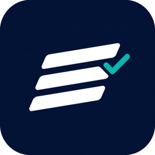

<p align="center">
  
</p>

# Ads Intel MCP (SteadyScrape)

A remote MCP server for competitive ad research: a company's Google Ads advertiser accounts and the ads it has run, as published in the [Google Ads Transparency Center](https://adstransparency.google.com), plus top-performing TikTok ads from Creative Center. All 4 tools are read-only. They do not create, buy, serve, place or target ads, and they return no sponsored content.

**Endpoint (Streamable HTTP):**

```
https://mcp.steadyscrape.dev/ads/mcp
```

The server is hosted on the [SteadyScrape MCP gateway](https://mcp.steadyscrape.dev/ads). Tools run in your own [Apify](https://apify.com/steady-scrape) account. Nothing to install or host. Docs: [steadyscrape.dev/ads-mcp](https://steadyscrape.dev/ads-mcp).

## Tools

All tools are read-only.

| Tool | What it does | Pricing |
|---|---|---|
| `find_google_advertisers` | Google Ads advertiser accounts that match 1–5 company or brand names in the Google Ads Transparency Center: name, advertiser ID, verification status, country, approximate ad count and related domains. | Billed per advertiser returned, via [Google Ads Transparency](https://apify.com/steady-scrape/google-ads-transparency) |
| `google_advertiser_ads` | Ads a company has run on Google (Search, YouTube, Shopping, Maps and Play) as published in the Ads Transparency Center, for 1–3 domains, advertiser IDs or Transparency Center URLs: format, first and last shown dates, days running, whether each is still running, preview image and Transparency Center link. Filter by region, platform, format and recency. | Billed per ad returned, via [Google Ads Transparency](https://apify.com/steady-scrape/google-ads-transparency) |
| `tiktok_top_ads` | Top-performing ads from TikTok Creative Center's public Top Ads library for 1–5 countries over the last 7, 30 or 180 days, optionally filtered by industry, objective and language: caption, brand when shown, CTR and likes as published, video links and the Creative Center link. | Billed per ad returned, via [TikTok Top Ads](https://apify.com/steady-scrape/tiktok-top-ads-creative-center) |
| `get_results` | Fetch results of a call that returned a `run_id` because it took longer than about two minutes. | Free (the original run is billed) |

Exact, current prices are on each Actor's Apify Store page. Current Free-plan list prices are also listed on the [docs page](https://steadyscrape.dev/ads-mcp). Errors and refused calls are free; listing tools and connecting cost nothing.

## Authentication

Either:

- **OAuth**: clients that support MCP OAuth (Claude.ai, VS Code, Cursor, ChatGPT developer mode) open an Apify sign-in the first time. Apify runs the sign-in (OAuth 2.1 with PKCE); SteadyScrape never sees your Apify password, or
- **API token**: send `Authorization: Bearer <APIFY_TOKEN>`. Get the token from [Console → Settings → API & Integrations](https://console.apify.com/settings/integrations).

You can revoke access any time in Apify Console → Settings → API & Integrations. New Apify accounts get free monthly credit ([sign up](https://console.apify.com/sign-up)).

## Client setup

**Claude.ai / Claude Desktop:** Settings → Connectors → *Add custom connector* → paste the endpoint URL → Connect, then sign in to Apify.

**Claude Code:**

```bash
claude mcp add --transport http steadyscrape-ads "https://mcp.steadyscrape.dev/ads/mcp"
```

**Cursor, Windsurf** and other clients that use `mcpServers`:

```json
{
  "mcpServers": {
    "steadyscrape-ads": { "url": "https://mcp.steadyscrape.dev/ads/mcp" }
  }
}
```

**VS Code** (`.vscode/mcp.json`):

```json
{
  "servers": {
    "steadyscrape-ads": { "type": "http", "url": "https://mcp.steadyscrape.dev/ads/mcp" }
  }
}
```

**Clients that only speak stdio:**

```json
{
  "mcpServers": {
    "steadyscrape-ads": { "command": "npx", "args": ["-y", "mcp-remote", "https://mcp.steadyscrape.dev/ads/mcp"] }
  }
}
```

**Token-only clients** can add an `Authorization` header (or the equivalent env var) with `Bearer <APIFY_TOKEN>`.

## Example prompts

- "Which Google advertiser accounts does HubSpot use?"
- "Show the 20 most recent Google ads from hubspot.com in the US, and which are still running."
- "Find Notion's Google advertiser account and show its 10 latest YouTube ads."
- "Show the top 5 TikTok ads in the US for Beauty & Personal Care over the last 30 days."

Agents should keep requests small (for example 20–40 ads) and use `get_results` if a call returns a `run_id`.

## Links

- Server page: https://mcp.steadyscrape.dev/ads
- Docs: https://steadyscrape.dev/ads-mcp
- Privacy: https://steadyscrape.dev/ads-mcp/privacy
- Support: https://mcp.steadyscrape.dev/support
- Terms: https://steadyscrape.dev/terms
- Official MCP Registry: `dev.steadyscrape/ads-intel` ([`server.json`](server.json))
- Glama: https://glama.ai/mcp/connectors/dev.steadyscrape/ads-intel ([`glama.json`](glama.json))
- More examples: [steadyscrape-examples](https://github.com/steadyscrape/steadyscrape-examples)

## Acceptable use

These tools are for competitive ad research only. They only read public ad-library data. You may not use them to create, buy, serve, place or target ads, or to build a competing ad-library product. Data are third-party publications (from Google Ads Transparency Center via DataForSEO, and from TikTok Creative Center) and may be incomplete or delayed.

## License

MIT. This repo contains configuration and docs only; the tools are paid services on Apify.
